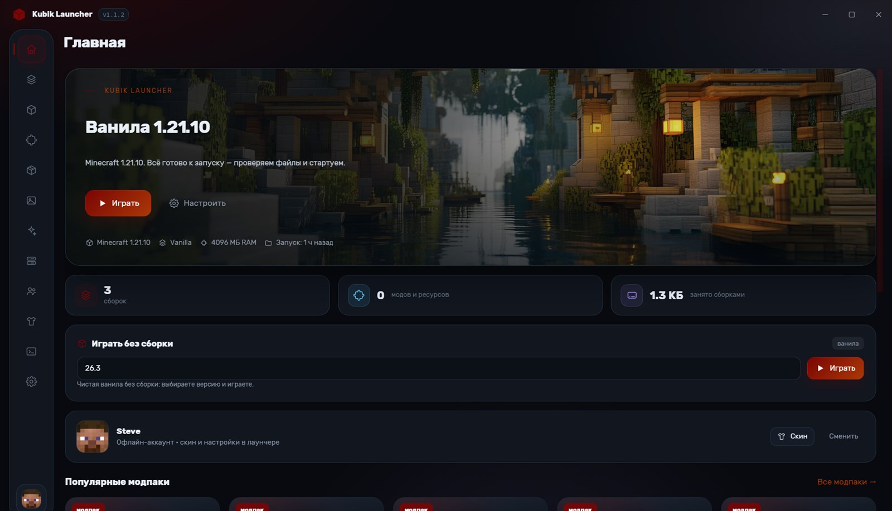
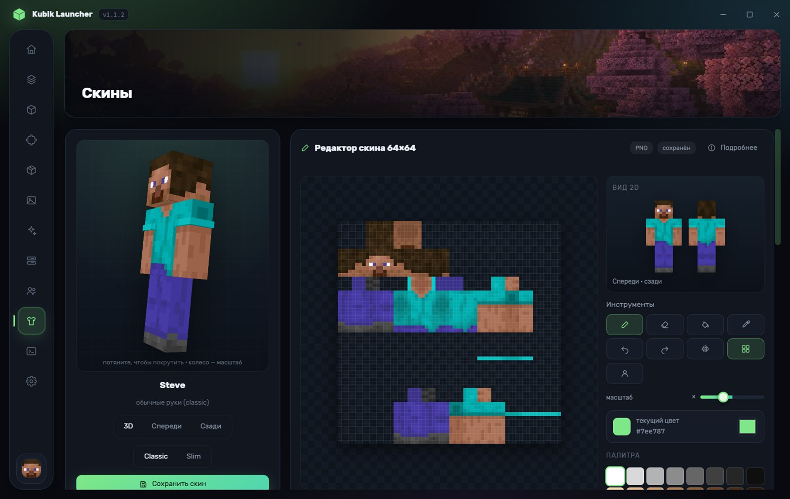
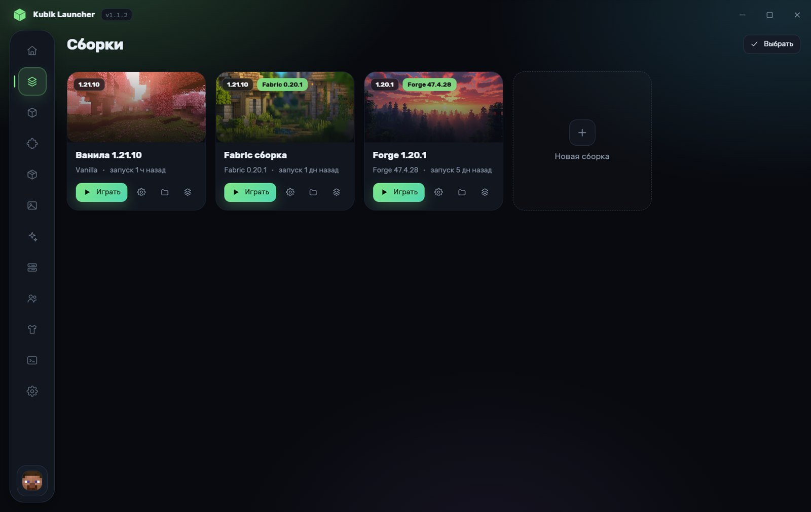
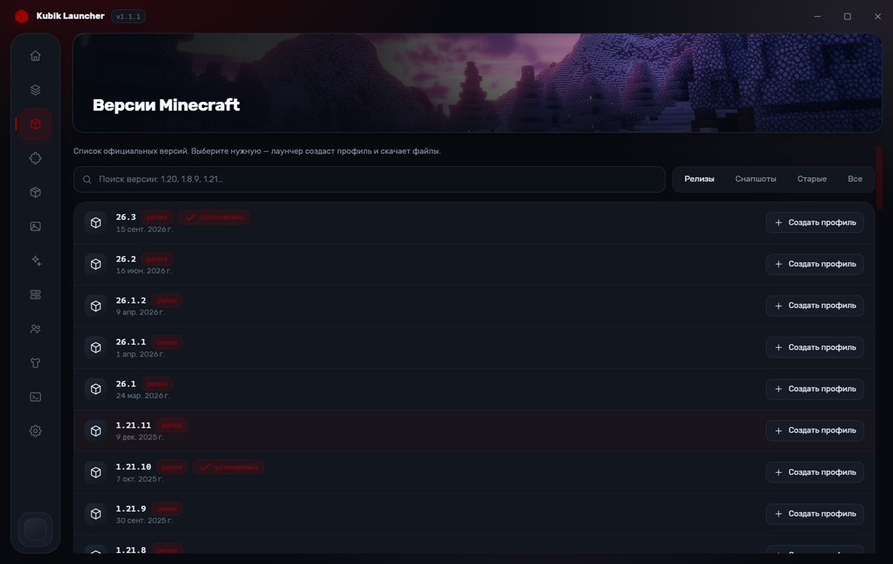
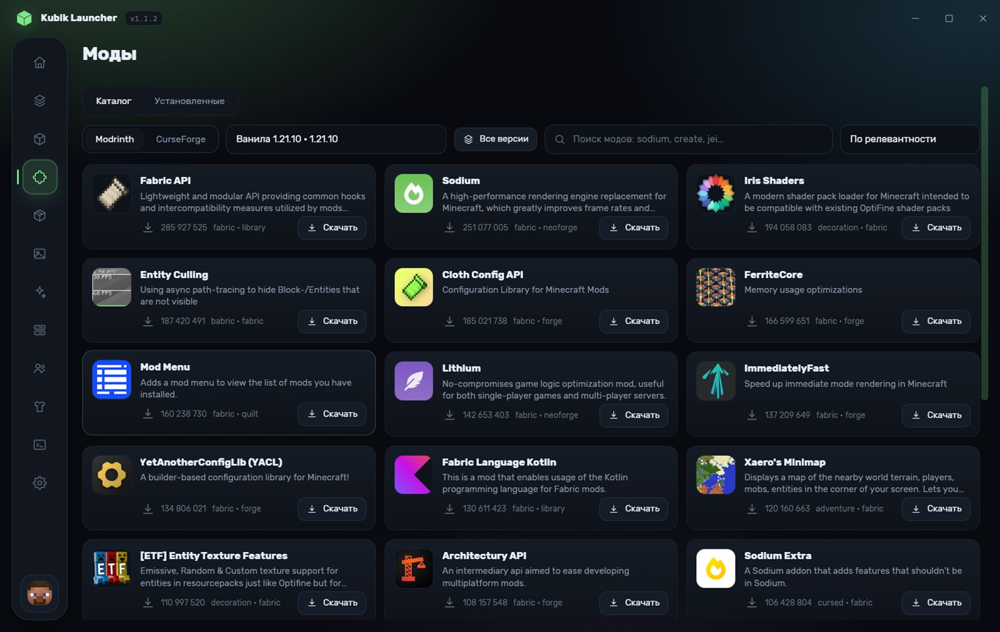
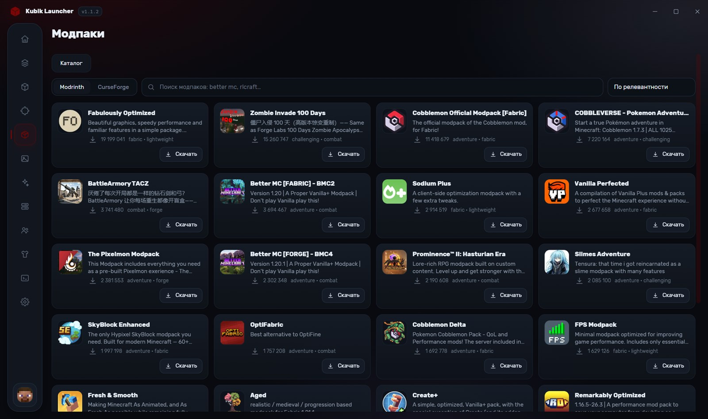
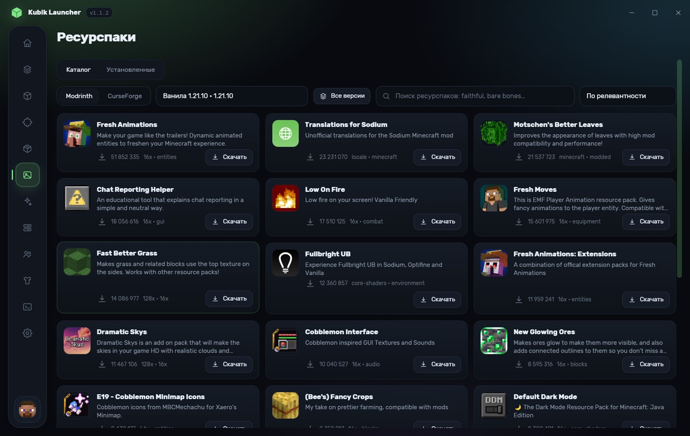
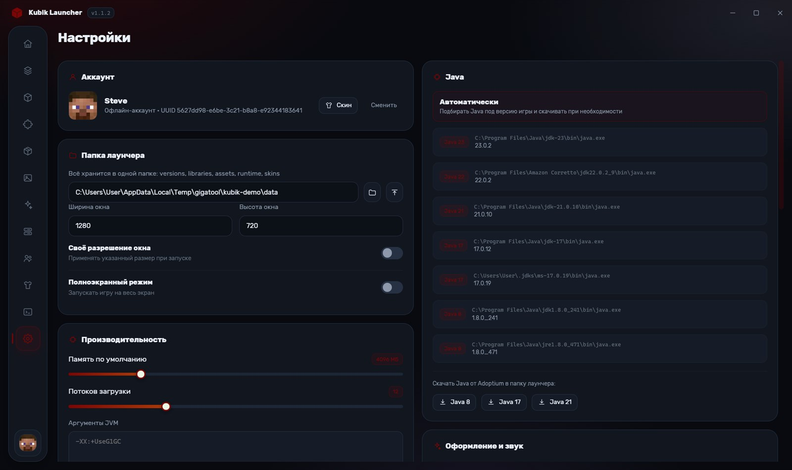

# Kubik Launcher

Лаунчер Minecraft для Windows: отдельные профили, версии Mojang, загрузчики модов, аккаунты и скины Ely.by, каталог Modrinth и встроенный пиксельный редактор скинов с 3D-просмотром.



## Скачать

- Сайт: https://name-studio.github.io/kubik-launcher/
- Релизы: https://github.com/NAME-studio/kubik-launcher/releases

| Файл | Для чего |
| --- | --- |
| `KubikLauncher-Setup-<версия>.exe` | установщик для Windows 10/11 x64 |
| `KubikLauncher-<версия>-portable.zip` | портативная версия: распаковать и запустить |
| `SHA256SUMS.txt` | контрольные суммы для проверки загрузки |

Установщик пока не подписан сертификатом, поэтому SmartScreen может показать «Windows защитила ваш компьютер»:
нажмите «Подробнее» → «Выполнить в любом случае» или сверьте хеш командой
`certutil -hashfile KubikLauncher-Setup-<версия>.exe SHA256` с `SHA256SUMS.txt`.

## Что умеет

- **Профили.** У каждой сборки своя папка `instances/<id>/.minecraft`: моды, ресурспаки, шейдеры, миры, настройки и логи не пересекаются. Обложки, память, разрешение окна, Java и аргументы — отдельно на профиль.
- **Версии.** Каталог Mojang с поиском и фильтрами (релизы, снапшоты, старые). Установка библиотек, нативных библиотек, ассетов и log4j-конфига с проверкой SHA1.
- **Загрузчики.** Vanilla, Fabric, Quilt (профиль из meta-API) и Forge/NeoForge (официальный установщик запускается автоматически).
- **Мгновенный запуск.** Подготовка занимает около 30 мс, а не 26 секунд: лаунчер запоминает отпечаток установленной версии, кэширует путь к Java и не ходит в сеть за authlib-injector. Полная проверка файлов запускается вручную. От нажатия «Играть» до старта процесса игры — около 1,1 с.
- **Понятные ошибки.** При сбое запуска окно с причиной и кнопками «Скопировать лог», «Открыть лог» и «Открыть папку сборки». Вторая сборка не запустится молча: лаунчер предупредит и предложит остановить текущую.
- **Сборки в архив.** Экспорт сборки в `.zip` (моды, конфиги, ресурспаки, шейдеры, манифест) и импорт обратно одной кнопкой.
- **Перевод описаний.** Описания модов и модпаков с Modrinth и CurseForge переводятся на русский автоматически, с кэшем на диске.
- **Серверы.** Пинг, онлайн, версия и MOTD; кнопка «Играть» запускает сборку с `--server` и `--port` и подключается сразу.
- **Мир в безопасности.** Перед игрой сохраняется копия миров в `backups` (последние три, не чаще раза в 30 минут), прогресс установки и запуска виден на иконке в панели задач.
- **Ely.by.** Вход по нику и паролю с поддержкой 2FA, хранение токена, обновление сессии. Скин подтягивается через authlib-injector и работает в игре и на серверах Ely.by.
- **Скины.** Свой и чужой скин, отдельная вкладка «Каталог» с автоподгрузкой при прокрутке и вкладка «Галерея» с сохранёнными скинами. Пиксельный редактор 64×64: карандаш, ластик, заливка, пипетка, симметрия, сетка, разметка частей тела, отмена и повтор, шаблоны Стива и Алекса, импорт PNG.
- **3D-просмотр.** Модель на WebGL: вращение мышью, зум колесом, слои скина, второй слой одежды. Окно «Подробнее» показывает модель крупно, 2D-виды спереди и сзади и характеристики скина.
- **Modrinth.** Поиск с фильтрами по версии игры и загрузчику, установка модов, ресурспаков и шейдеров, автоустановка обязательных зависимостей, включение и выключение модов, удаление, проверка обновлений.
- **Модпаки.** Установка `.mrpack`: создаётся отдельный профиль под нужную версию и загрузчик, файлы качаются из манифеста, `overrides` и `client-overrides` распаковываются.
- **Настройки.** Память, потоки загрузки, JVM и игровые аргументы, Java (список найденных и скачивание), папка данных, разрешение, полноэкранный режим, поведение лаунчера, диагностика, тёмная и светлая тема, акцентный цвет, звуки.
- **Логи.** Все запуски пишутся в `<данные>\logs`, консоль доступна в лаунчере.

## Скины и редактор



Модель можно крутить мышью, приближать колесом и сбрасывать двойным кликом. В редакторе слева — холст 64×64, справа — живые 2D-виды спереди и сзади, палитра и инструменты. Кнопка «Подробнее» открывает крупный 3D-просмотр вместе с характеристиками: игрок, модель, разрешение, формат и вес файла.

## Сборки и версии




## Каталог Modrinth





## Настройки



## Запуск

| Способ | Что делать |
| --- | --- |
| Портативный exe | `release\KubikLauncher.exe` — ничего устанавливать не нужно |
| Через bat | `start.bat` (сам поставит зависимости при первом запуске) |
| Из исходников | `npm.cmd start` в папке проекта |

Требования: Windows 10/11 x64. Node.js нужен только для запуска из исходников. Java лаунчер находит сам (Java 8/17/21/23 в системе) и при необходимости скачивает JRE от Adoptium.

## Сборка установщика

```bat
npm.cmd install
npm.cmd run dist
```

Результат — `release\KubikLauncher-Setup-<версия>.exe` и портативный `release\KubikLauncher.exe`.

## Где лежат данные

`%APPDATA%\KubikLauncher`

```
config.json          настройки лаунчера
accounts.json        аккаунты (токены Ely.by / локальные профили)
data\versions\       json и jar версий Mojang
data\libraries\      библиотеки
data\assets\         ресурсы, индексы, virtual для legacy
data\runtime\        скачанные JRE
data\instances\      профили (<id>\instance.json и <id>\.minecraft)
data\logs\           логи запусков
```

## Друзья через Firebase

Друзья и общие сборки работают без своего сервера — на Firestore. Ключи проекта хранятся только на компьютере в `config.json` и не вшиваются в исходники.

Если Firestore отвечает `429`, это исчерпан суточный лимит бесплатного тарифа. Лаунчер сам ставит паузу, показывает обратный отсчёт и не повторяет запросы каждую секунду: список друзей читается пакетно, а опрос сокращён до 20 секунд.

## Технологии

Electron, чистый JavaScript и CSS без фреймворков, Canvas 2D для 2D-скинов, WebGL для 3D-модели, Firestore REST для друзей, Modrinth API и Mojang meta для контента.

## Лицензия

MIT
